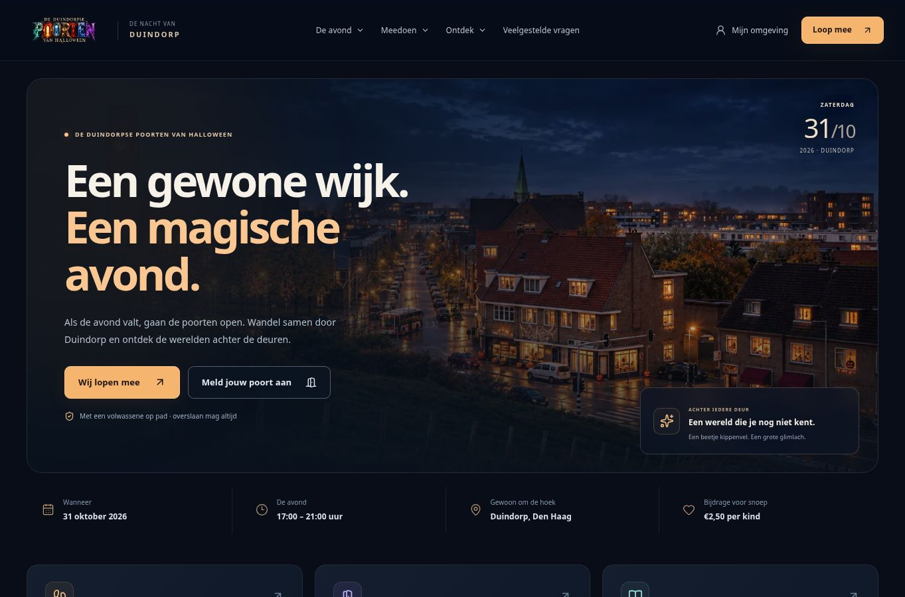
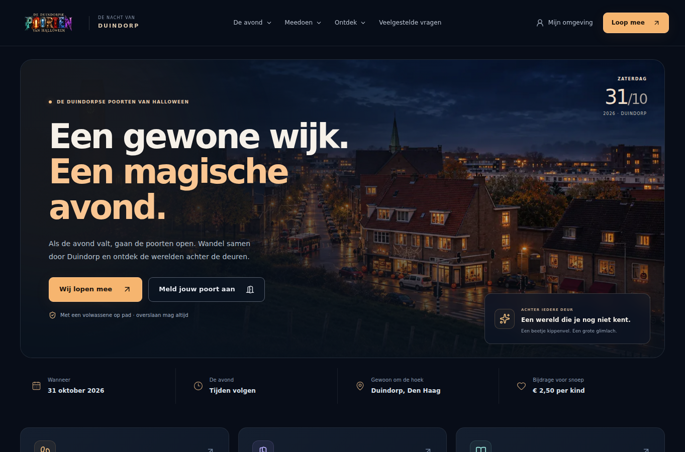

# Visuele vergelijking en open verschillen

Referentie: vastgezette bron/CSS/assets uit de gecontroleerde overdracht. Productie heeft geen prototypebalk; `--prototype-bar-height` is nul. De screenshot van 1363×936 is bovenaan 36 pixels bijgesneden tot 1363×900, DPR 1. Afwijkende referentiematen zijn niet als dezelfde viewport behandeld.

| Referentie zonder balk | Lokale Next-weergave |
| --- | --- |
|  |  |

Desktopgemeten: headerhoogte 92 px, hero x=40/y=118/breedte=1283/hoogte=595. Deze buitenmaten sluiten aan bij de genormaliseerde homepage-referentie. De inhoud bevat echte openbaar gelezen eventinformatie; namen/aantallen kunnen afwijken van fictieve referentiegegevens. Er zijn geen layoutmaskers gebruikt om verschillen weg te poetsen.

**Fontmetriek wijkt af.** Chromium op deze Linux-omgeving meldt via CDP daadwerkelijk DejaVu Sans Bold voor de hero, ondanks de CSS-fontnamen. De tekstbreedte/omloop komt niet exact overeen met de capture. Tijdelijke Arial-, Inter-, Inter 3.19- en Roboto-proeven leverden geen bewezen identieke referentiemetriek op; geen van die downloads is als productfont toegevoegd. De broncascade is behouden. Het oorspronkelijke werkelijk gebruikte referentiefont en een reproduceerbare match moeten nog worden vastgesteld. Pixelperfect is daarom niet afgetekend.

`scripts/acceptance/redesign-visual.mjs` maakt 20 captures van de echte lokale Next-productiebouw: homepage op 1363/360/390/430/768 px, mobiel menu op 390 px en 14 overige publieke pagina's op desktop. Resultaten en CDP-meting: [public-browser-results.json](validation/public-browser-results.json). Geen gemeten horizontale overflow of homepage-JavaScriptfout. Deze meting is geen volledige toegankelijkheidscontrole en geen bewijs voor ingelogde flows.

Nieuwe captures zijn nodig voor alle ouder-/meekijker-/poort-/admin-/kinderomgevingen, QR/aankomst-/afsluit-/lees-/tourdialogen en relevante lege/fout-/focusstaten, met identieke inhoudsviewport, scroll en dialoogstatus. Echte privégegevens alleen in een beveiligde QA-omgeving; gebruik synthetische geautoriseerde testgezinnen voor deelbaar bewijs. Publieke regressietests voor toetsenbord, reduced motion en 200% tekstzoom slagen; daarbij zijn het sponsorgrid en de tabletkaartbediening gecorrigeerd in de afzonderlijke productielaag. Nog open: dezelfde controles in ingelogde omgevingen, contrast, screenreader, safe areas, Messenger/ondernavigatie-overlap en volledige reduced-motioncontrole.

Zes gegenereerde PDF's zijn met een onafhankelijke PDF-renderer geopend: bewaarkaart met 0/2/5/40 eigen fixturezegels en mono/kleur-A4-posters. Bij 40 zegels ontstaan zeven pagina's. Tekstextractie vond de eigen naam en geen verboden fixture-adres/credential in de bewaarkaart. Voorbeelden: [kaart](validation/book-40-page1.png), [zwart-witposter](validation/poster-mono-page1.png), [kleurposter](validation/poster-colour-page1.png). Dit zijn fictieve QA-gegevens, geen productieposters. Fysieke QR-decode/afdruk en volledige visuele referentiematch staan open.
